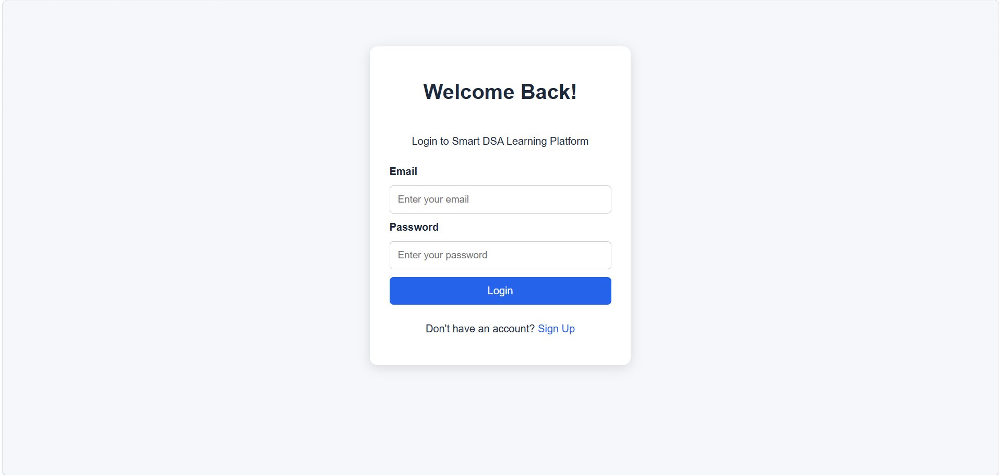
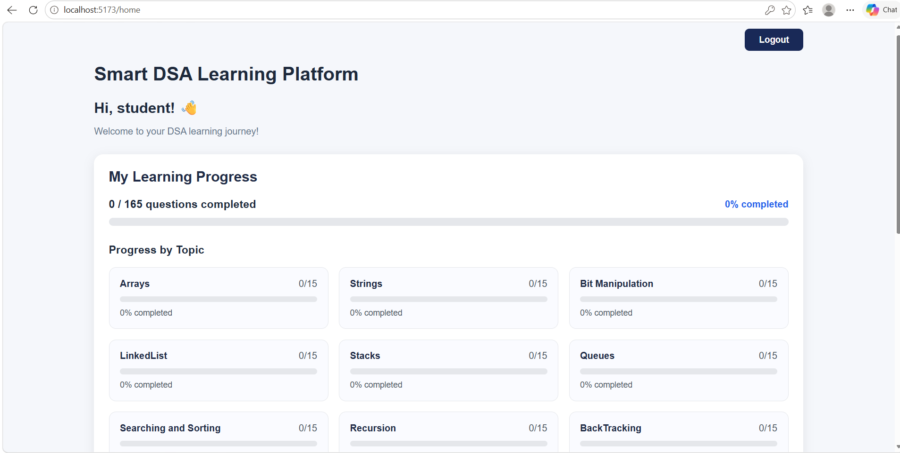
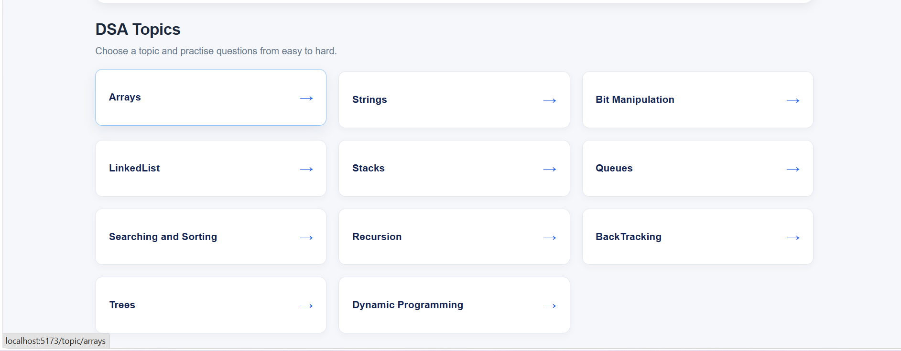

# Smart DSA Learning and Practice Platform

## 📌 About the Project

The **Smart DSA Learning and Practice Platform** is a web-based application designed to help students learn and practice Data Structures and Algorithms (DSA) in a structured way. It organizes important DSA topics and provides practice questions categorized by difficulty level.

The platform helps students track their learning progress, identify completed questions, and follow a systematic approach to DSA preparation.

## 🎯 Objectives

- Provide a structured learning path for DSA topics.
- Organize practice questions from easy to difficult.
- Provide links to external coding platforms such as LeetCode and GeeksforGeeks.
- Track completed questions for each student.
- Display topic-wise and overall learning progress.
- Store student information and progress in a database.

## ✨ Features

- **Student Registration and Login:** Allows students to create an account and log in.
- **DSA Topic Categories:** Covers 11 important DSA topics.
- **Practice Questions:** Provides questions per topic.
- **Difficulty Filtering:** Helps students find questions according to their difficulty level.
- **Question Search:** Allows students to search for specific questions.
- **External Practice Links:** Redirects students to coding platforms to solve problems.
- **Progress Tracking:** Allows students to mark questions as completed.
- **Dashboard:** Displays overall completion percentage and topic-wise progress.
- **Database Persistence:** Stores student records and solved-question progress in MySQL.

## 📚 Topics Covered

1. Arrays
2. Strings
3. Bit Manipulation
4. Linked List
5. Stacks
6. Queues
7. Searching and Sorting
8. Recursion
9. Backtracking
10. Trees
11. Dynamic Programming

## 🛠️ Technologies Used

### Frontend
- React.js
- Vite
- JavaScript
- HTML5
- CSS3
- React Router

### Backend
- Java
- Spring Boot
- Spring Data JPA
- Spring Security and BCrypt password hashing
- REST APIs

### Database
- MySQL

### Development Tools
- Visual Studio Code
- Maven
- Git
- GitHub
- Node.js and npm

## 🏗️ Project Architecture

The application follows a frontend-backend-database architecture.

1. **Frontend:** React provides the user interface, topic pages, login forms, and progress dashboard.
2. **Backend:** Spring Boot exposes REST endpoints to handle authentication, question retrieval, and progress operations.
3. **Database:** MySQL stores student details and completed-question records.
4. **Communication:** The frontend communicates with the backend using HTTP requests and JSON.

## 📂 Project Structure

```text
smart-dsa-learning-platform/
├── backend/
│   ├── src/
│   │   ├── main/
│   │   │   ├── java/com/anurag/backend/
│   │   │   └── resources/
│   │   └── test/
│   ├── pom.xml
│   └── mvnw.cmd
│
└── frontend/
    ├── public/
    ├── src/
    │   ├── Data/
    │   ├── Pages.jsx/
    │   ├── App.jsx
    │   ├── App.css
    │   └── main.jsx
    ├── package.json
    └── vite.config.js
```

## ⚙️ Prerequisites

Install the following before running the application:

- Java Development Kit (JDK)
- Node.js and npm
- MySQL Server
- Git

## 🚀 How to Run the Project


### 1. Configure the Database

Create a MySQL database named:

```sql
CREATE DATABASE smart_dsa_db;
```

Then set up the backend configuration:

1. Go to `backend/src/main/resources/`.
2. Copy `application.properties.example` and rename the copy to `application.properties`.
3. Open it and enter your own MySQL username and password.

Do not commit real database passwords or other secrets to GitHub.

### 2. Start the Backend

Open a terminal in the `backend` directory and run:

```powershell
.\mvnw.cmd spring-boot:run
```

The backend runs at:

`http://localhost:8080`

### 3. Start the Frontend

Open another terminal and run:

```bash
cd frontend
npm install
npm run dev
```

Open the local URL displayed by Vite, normally:

`http://localhost:5173`


## 🎓 Learning Outcomes

This project provides practical experience with:

- Building a React single-page application.
- Implementing REST APIs using Spring Boot.
- Connecting a Java backend to MySQL using Spring Data JPA.
- Implementing student registration and login.
- Managing frontend routing and state.
- Persisting and displaying user-specific progress.
- Integrating frontend, backend, and database components.


## Screenshots

### Login Page



### DashBoard Page



### Topics Page




## 👩‍💻 Author

**J.Sharmila**

